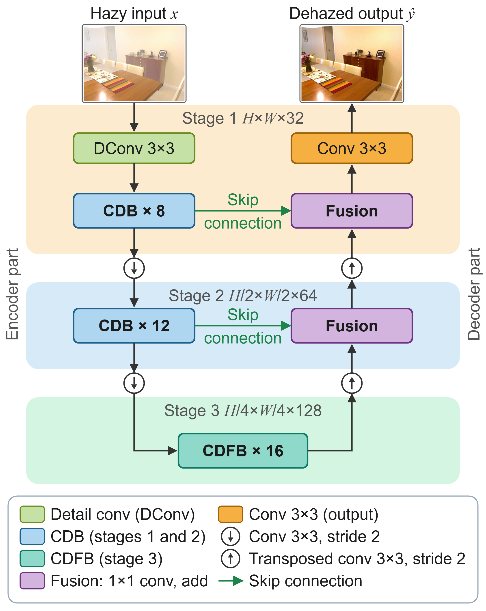

# CDFDNet: A Composite Detail-Frequency Dehazing Network for Single Image Haze Removal

Official PyTorch implementation of **CDFDNet** (manuscript submitted to *IEEE Access*, under review).

CDFDNet is a three-stage U-shaped convolutional network for single image dehazing, designed along two axes:

* **Spatial axis: detail convolutions.** A detail convolution places a vanilla 3×3 convolution in parallel
  with four difference convolutions (central, angular, horizontal and vertical). At the network entrance,
  detail convolutions act as an edge prior; inside the blocks they preserve details: in the fine-scale branch
  of the dual-scale detail convolution and, with the four difference convolutions extended to a dilated form,
  in the tri-scale dilated detail convolution. Before inference, every detail convolution is merged into a
  single standard convolution, so the deployment cost is unchanged.
* **Frequency axis: frequency modulation.** Frequency modulation in the deepest-stage blocks adjusts the
  global haze distribution by applying 1×1 convolutions separately to the real and imaginary parts of the
  feature spectrum.

Stages 1 and 2 are built from Composite Detail Blocks (CDB); stage 3 is built from Composite
Detail-Frequency Blocks (CDFB). The deployed model has about half the parameters and MACs of its base architecture
(ComplexDehazeNet).

<p align="center"></p>

Each block chains BN → CRA → TSDW → TSDD → LKS → DSD → (FM, CDFB only) → FFN with a block-level residual:
batch normalization (BN), composite residual attention (CRA), tri-scale depthwise convolution (TSDW),
tri-scale dilated detail convolution (TSDD), large-kernel and strip convolution (LKS), dual-scale detail
convolution (DSD), frequency modulation (FM) and a feed-forward network (FFN). The same abbreviations are used
as step names in `cdfdnet/models/blocks.py`.

## Installation

```bash
git clone https://github.com/nick111432009-beep/CDFDNet.git
cd CDFDNet
pip install -r requirements.txt      # a CUDA GPU is recommended
```

Training was run on one NVIDIA RTX PRO 6000 Blackwell GPU. The released code and weights were verified with
Python 3.13, PyTorch 2.12 and CUDA 12.6 on an NVIDIA RTX 3080.

## Data preparation

Scripts expect paired folders in which a hazy image and its clear image have the same file name:

```
data/RESIDE-IN/train/{hazy,GT}/   # RESIDE ITS, 13,990 pairs
data/RESIDE-IN/test/{hazy,GT}/    # SOTS-Indoor, 500 pairs (620×460)
data/I-HAZE/train/{hazy,GT}/      # I-HAZE pairs 01–25
data/I-HAZE/test/{hazy,GT}/       # I-HAZE pairs 31–35
```

`scripts/prepare_dataset.py pair` builds this layout from the official downloads of RESIDE and I-HAZE
(files are hard-linked when possible). Replace the source paths with those of your copies:

```bash
python scripts/prepare_dataset.py pair --hazy <ITS>/hazy  --gt <ITS>/clear --dst data/RESIDE-IN/train
python scripts/prepare_dataset.py pair --hazy <SOTS-indoor>/hazy --gt <SOTS-indoor>/gt --dst data/RESIDE-IN/test
python scripts/prepare_dataset.py pair --hazy <I-HAZE>/hazy --gt <I-HAZE>/GT --dst data/I-HAZE/train --ids 1-25
python scripts/prepare_dataset.py pair --hazy <I-HAZE>/hazy --gt <I-HAZE>/GT --dst data/I-HAZE/test  --ids 31-35
```

GT files are matched by name: RESIDE hazy images `1400_1.png` or `1_1_0.90179.png` pair with `1400.png` or
`1.png`, and I-HAZE images `31_indoor_hazy.jpg` pair with `31_indoor_GT.jpg`. Pairs 26–30 of I-HAZE are not
used. Only the test folders are needed to reproduce the results below.

## Pretrained weights

Two deployed (re-parameterized) models, 25.80 M parameters each, are attached to the
[v1.0.0 release](https://github.com/nick111432009-beep/CDFDNet/releases/tag/v1.0.0):

| File | Trained on | Size (bytes) | SHA-256 |
|---|---|---|---|
| `cdfdnet_sots_indoor.pth` | RESIDE ITS | 104,011,043 | `c0bf465a1118ecfa308625cf79eb8b6615d275b07315122b18367be9551e4ffd` |
| `cdfdnet_ihaze.pth` | I-HAZE (pairs 01–25) | 103,996,663 | `52144587e9f67bd0e23e7a58e0f5938511173ccf9a7a7bf65c3edd1b47191572` |

```bash
mkdir -p weights
wget -P weights https://github.com/nick111432009-beep/CDFDNet/releases/download/v1.0.0/cdfdnet_sots_indoor.pth
wget -P weights https://github.com/nick111432009-beep/CDFDNet/releases/download/v1.0.0/cdfdnet_ihaze.pth
sha256sum weights/*.pth
```

Each file is a dict with `model_cfg`, `state_dict` and `meta` that contains only tensors and plain Python
values, so it is loaded with `torch.load(..., weights_only=True)`.

The dehazed test images produced by these weights (with per-image PSNR and SSIM in a CSV file) are attached to
the same release as `cdfdnet_results_sots_indoor.zip` (500 images) and `cdfdnet_results_ihaze.zip` (5 images).

## Inference and evaluation

```bash
# SOTS-Indoor: whole-image inference at full resolution
python scripts/infer.py --weights weights/cdfdnet_sots_indoor.pth \
    --input data/RESIDE-IN/test/hazy --gt data/RESIDE-IN/test/GT --output out_sots

# I-HAZE: 1024×1024 tiles with an overlap of 128 pixels; metrics on the central 256×256 region
python scripts/infer.py --weights weights/cdfdnet_ihaze.pth \
    --input data/I-HAZE/test/hazy --gt data/I-HAZE/test/GT --output out_ihaze \
    --tile 1024 --overlap 128 --center-crop 256
```

`infer.py` prints the mean PSNR and SSIM (add `--metrics file.csv` for per-image values, `--no-save` to
skip writing images). Without `--gt` it only dehazes; `--input` may also be a single image. From Python:

```python
from cdfdnet.inference import load_model, dehaze
net = load_model('weights/cdfdnet_sots_indoor.pth')        # uses CUDA if available
dehaze(net, 'hazy.png').save('dehazed.png')                 # whole image; for larger images see "Input size" below
```

**Input size.** The SOTS-Indoor weights were trained on 256×256 crops and evaluated on 620×460 images, and they
are sensitive to the input size. On inputs larger than the test images the accuracy drops (by about 4 dB at twice
the side length in our test, and the output breaks down at about 2.5× and beyond). Process larger images in tiles
close to the test size, e.g. `dehaze(net, img, tile=512)`: in the same test this stays within about 0.6 dB of the
result at the original size, whereas `tile=1024` loses about 3.6 dB. The I-HAZE weights are used with 1024×1024
tiles, as in the paper.

`scripts/evaluate.py --pred <folder> --gt <folder> [--center-crop 256]` measures images that are already
saved; because these are 8-bit files, its numbers are lower than those of `infer.py` (PSNR by about 0.31 dB on
SOTS-Indoor and by less than 0.01 dB on I-HAZE). The results below are the floating-point values of `infer.py`.

## Training

```bash
# SOTS-Indoor: batch 16, 256×256 crops, AdamW 2e-4 with cosine decay to 1%, 1500 epochs, AMP
python scripts/train.py --config configs/cdfdnet_sots_indoor.yaml --override data.root=data/RESIDE-IN

# I-HAZE: batch 8, 256×256 crops, 8000 epochs (validation on a central 256×256 crop during training)
python scripts/train.py --config configs/cdfdnet_ihaze.yaml --override data.root=data/I-HAZE
```

The loss is L1 + 0.1·L_freq + 0.1·L_ucr: a frequency-domain L1 loss and a contrastive loss with uniform
weights over the four stages of an ImageNet-pretrained ResNet-152 (downloaded by torchvision on first use).
With batch size 16 the peak GPU memory is about 60 GB. Running the same command again resumes from
`ckpt/<name>_last.pth`, and `--max-hours N` stops cleanly after N hours. Checkpoints keep the training form
(56.52 M parameters); fold them into the deployed form with

```bash
python scripts/fold_deploy.py --ckpt ckpt/cdfdnet_sots_indoor.pth --out weights/my_cdfdnet.pth
```

which replaces every detail convolution by an equivalent standard (dilated) 3×3 convolution, checks that the
deployed network reproduces the training form and saves the deployed weights.
`scripts/export_model.py` packages a checkpoint in the training form instead.

## Results

| Dataset | PSNR (dB) | SSIM | Params (deployed) | MACs (224×224) |
|---|---|---|---|---|
| SOTS-Indoor (500 images, 620×460) | 47.67 | 0.9985 | 25.80 M | 144.49 G |
| I-HAZE (5 test images, central 256×256) | 24.22 | 0.731 | 25.80 M | 144.49 G |

PSNR and SSIM are computed on the floating-point network output clipped to [0, 1], before it is stored as an
8-bit image. PSNR is computed at the original resolution over the RGB channels without border cropping; SSIM
is computed after downsampling by round(min(H, W)/256) with an 11×11 Gaussian window (σ = 1.5)
(`cdfdnet/engine/evaluate.py`). I-HAZE outputs are obtained by tiled full-resolution inference
(1024×1024 tiles, overlap 128).

## Citation

```bibtex
@article{chen2026cdfdnet,
  title   = {CDFDNet: A Composite Detail-Frequency Dehazing Network for Single Image Haze Removal},
  author  = {Chen, Yen-Chang and Liu, Yuan-Chen},
  journal = {IEEE Access},
  year    = {2026},
  note    = {under review}
}
```

## Acknowledgements

* The three-stage backbone follows **ComplexDehazeNet** (J. Choi and J.-M. Chung, *IEEE Access*, 2025).
* The detail convolution is adapted from the detail-enhanced convolution (DEConv) of **DEA-Net**
  (Z. Chen, Z. He and Z.-M. Lu, *IEEE Trans. Image Process.*, 2024).
* Frequency modulation is adapted from **DGFDNet** (L. Zheng, Y. Li, R. Yu and K. Zhang, "Efficient
  dual-domain image dehazing with haze prior perception," *Pattern Recognition*, 2027).
* The strip shapes of the large-kernel and strip convolution follow **ConvIR** (Y. Cui, W. Ren, X. Cao and
  A. Knoll, *IEEE Trans. Pattern Anal. Mach. Intell.*, 2024) in static form.

## License

This project is released under the MIT License; see [LICENSE](LICENSE).

**Third-party code.** Parts of this repository are adapted from two projects that are distributed under the
MIT License; their license notices are reproduced below.

* The backbone modules (`cdfdnet/models/net.py`, `cdfdnet/models/blocks.py`) and the contrastive loss
  (`cdfdnet/losses/losses.py`) are adapted from the official implementation of
  [ComplexDehazeNet](https://github.com/DavidcOfficial/ComplexDehazeNet).
* The paired data loader and augmentation (`cdfdnet/data/loader.py`) and the `AverageMeter` helper
  (`cdfdnet/engine/train.py`) are adapted from [DehazeFormer](https://github.com/IDKiro/DehazeFormer).

<details>
<summary>ComplexDehazeNet license</summary>

```
MIT License

Copyright (c) 2025 Davidc

Permission is hereby granted, free of charge, to any person obtaining a copy
of this software and associated documentation files (the "Software"), to deal
in the Software without restriction, including without limitation the rights
to use, copy, modify, merge, publish, distribute, sublicense, and/or sell
copies of the Software, and to permit persons to whom the Software is
furnished to do so, subject to the following conditions:

The above copyright notice and this permission notice shall be included in all
copies or substantial portions of the Software.

THE SOFTWARE IS PROVIDED "AS IS", WITHOUT WARRANTY OF ANY KIND, EXPRESS OR
IMPLIED, INCLUDING BUT NOT LIMITED TO THE WARRANTIES OF MERCHANTABILITY,
FITNESS FOR A PARTICULAR PURPOSE AND NONINFRINGEMENT. IN NO EVENT SHALL THE
AUTHORS OR COPYRIGHT HOLDERS BE LIABLE FOR ANY CLAIM, DAMAGES OR OTHER
LIABILITY, WHETHER IN AN ACTION OF CONTRACT, TORT OR OTHERWISE, ARISING FROM,
OUT OF OR IN CONNECTION WITH THE SOFTWARE OR THE USE OR OTHER DEALINGS IN THE
SOFTWARE.
```

</details>

<details>
<summary>DehazeFormer license</summary>

```
MIT License

Copyright (c) 2022 IDKiro

Permission is hereby granted, free of charge, to any person obtaining a copy
of this software and associated documentation files (the "Software"), to deal
in the Software without restriction, including without limitation the rights
to use, copy, modify, merge, publish, distribute, sublicense, and/or sell
copies of the Software, and to permit persons to whom the Software is
furnished to do so, subject to the following conditions:

The above copyright notice and this permission notice shall be included in all
copies or substantial portions of the Software.

THE SOFTWARE IS PROVIDED "AS IS", WITHOUT WARRANTY OF ANY KIND, EXPRESS OR
IMPLIED, INCLUDING BUT NOT LIMITED TO THE WARRANTIES OF MERCHANTABILITY,
FITNESS FOR A PARTICULAR PURPOSE AND NONINFRINGEMENT. IN NO EVENT SHALL THE
AUTHORS OR COPYRIGHT HOLDERS BE LIABLE FOR ANY CLAIM, DAMAGES OR OTHER
LIABILITY, WHETHER IN AN ACTION OF CONTRACT, TORT OR OTHERWISE, ARISING FROM,
OUT OF OR IN CONNECTION WITH THE SOFTWARE OR THE USE OR OTHER DEALINGS IN THE
SOFTWARE.
```

</details>

## Contact

For questions, please open an issue or contact the corresponding author, Yuan-Chen Liu
(`liu@tea.ntue.edu.tw`).
